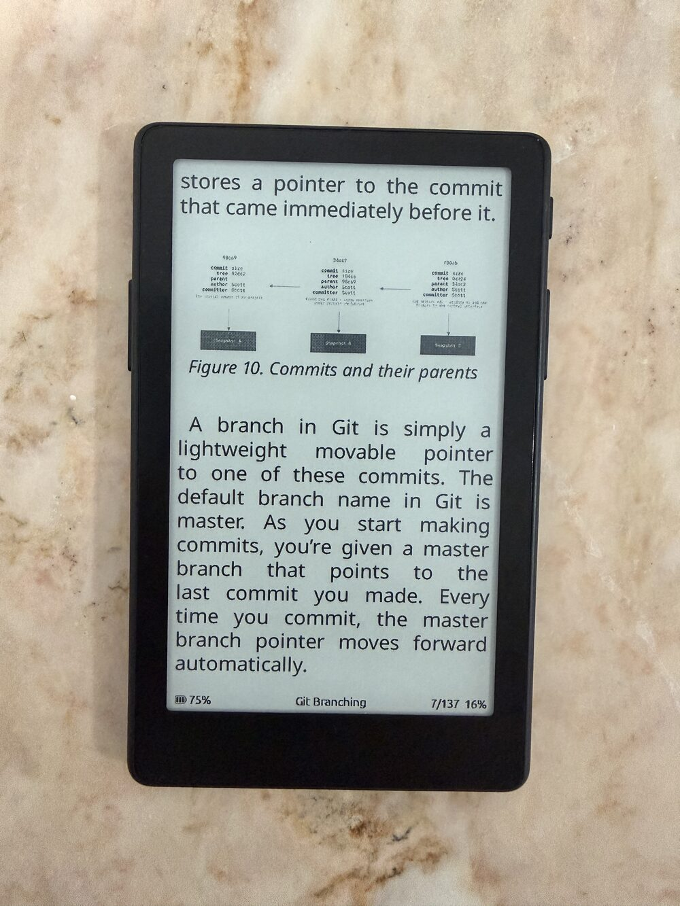
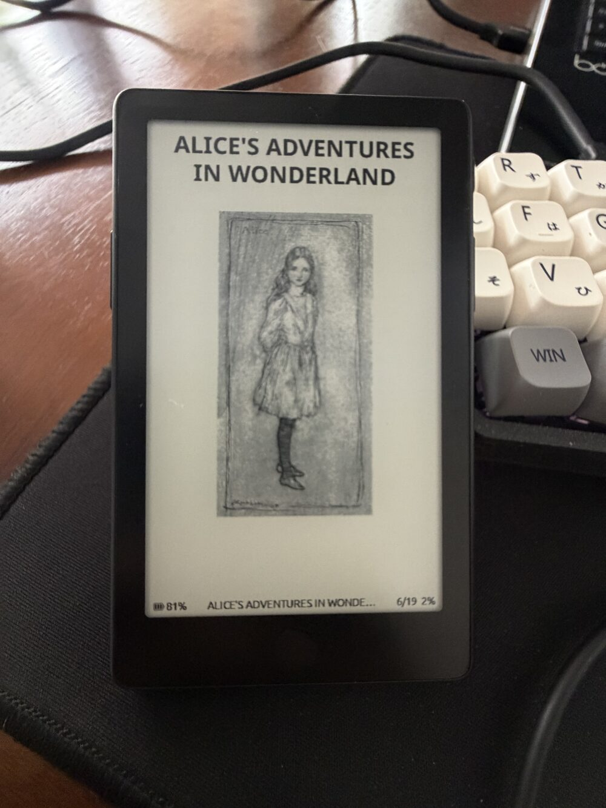

# prensa

Optimize EPUBs for e-ink readers before copying them to the device.

Most EPUBs are made for phones and computers: large color images, progressive
JPEGs, embedded fonts. Small e-ink readers with little memory struggle with
them. `prensa` writes an optimized copy of the book that is smaller, sharper
and easier on the device, and it never touches the original file.

It is tuned on an **Xteink X4 Pro** running the
[CrossPoint](https://github.com/crosspoint-reader/crosspoint-reader) firmware,
but the output is still a standard EPUB that opens in any reader.

## Before and after

Photos of the same page on an Xteink X4 Pro (CrossPoint), original book on the
left, `prensa` output on the right.

### Missing image → visible

Wide PNG diagrams overflow CrossPoint's PNG line buffer and are silently
dropped. `prensa` downscales them, so they show up.

| Before | After |
|---|---|
|  |  |

*Pro Git, Figure 10. 24 of the book's 188 images are dropped by the firmware; after `prensa`, all of them render.*

### Unreadable → readable

Large diagrams are downscaled on the device with a simple fixed-point scaler,
which mangles small text. `prensa` does the same downscale on your computer
with a high-quality filter and light sharpening.

| Before | After |
|---|---|
|  |  |

*Mastering Bitcoin, Figure 2-2.*

### Blurry → sharp

CrossPoint decodes progressive JPEGs at 1/8 resolution. `prensa` re-encodes
them as baseline JPEGs.

| Before | After |
|---|---|
|  |  |

*Alice's Adventures in Wonderland, illustrated by Arthur Rackham (images converted to progressive JPEG to reproduce the issue).*

### File size

| Book | Original | Optimized | Reduction |
|---|---|---|---|
| Pro Git (2.1.450) | 13.99 MB | 2.68 MB | −81% |
| Mastering Bitcoin (3rd ed.) | 6.6 MB | 2.0 MB | −70% |

Each book takes about a second or less to process, a few seconds for Pro Git.

## Install

Requires a Rust toolchain.

```sh
cargo install --git https://github.com/eoSalinas/prensa
```

## Usage

```sh
prensa book.epub book-optimized.epub
```

```text
fonts removed: 13 file(s), 0.7 MB
images: 187 optimized, 1 kept, 15.5 -> 2.3 MB
```

Then copy `book-optimized.epub` to the device.

### Options

| Option | Default | Description |
|---|---|---|
| `--max-width <PX>` | `440` | Maximum image width |
| `--max-height <PX>` | `733` | Maximum image height |
| `--quality <1-100>` | `92` | JPEG quality |
| `--sharpen <SIGMA>` | `0.8` | Unsharp mask after downscaling; `0` disables it |

The defaults won a side-by-side comparison on the device. They favor
legibility over the smallest possible file.

## What it does

- **Fonts:** removes embedded font files, their manifest entries, `@font-face`
  rules and font entries in `META-INF/encryption.xml`. CrossPoint ignores
  `@font-face` and always renders with its own fonts, so they are dead weight.
- **Images:** fits every JPEG and PNG into 440×733 (never upscales), converts
  it to grayscale (flattening transparency onto white), and writes JPEGs as
  baseline. If the result is not smaller and the image did not need to change,
  the original is kept.

## Guarantees

- The input file is never modified; the output is written atomically.
- The visible text of the book is identical before and after. This is checked
  by a property-based test over randomly generated books.
- The output is a valid EPUB container (`mimetype` first and uncompressed).

## Limitations

- Tuned for CrossPoint on a 480×800 screen. Readers that use embedded fonts
  (e.g. KOReader) will fall back to their own fonts after `prensa` removes them.
- Very wide diagrams become visible but their smallest text can still be hard
  to read at 440 px.
- Thin light-gray lines can look dashed after the device's 4-level dithering.

## Credits

Photos show pages from:

- [*Pro Git*](https://git-scm.com/book) by Scott Chacon and Ben Straub, licensed
  under [CC BY-NC-SA 3.0](https://creativecommons.org/licenses/by-nc-sa/3.0/).
- [*Mastering Bitcoin*](https://github.com/bitcoinbook/bitcoinbook) by Andreas M.
  Antonopoulos and David A. Harding, licensed under
  [CC BY-SA 4.0](https://creativecommons.org/licenses/by-sa/4.0/).
- *Alice's Adventures in Wonderland* by Lewis Carroll, illustrated by Arthur
  Rackham ([Project Gutenberg #28885](https://www.gutenberg.org/ebooks/28885)),
  public domain.

