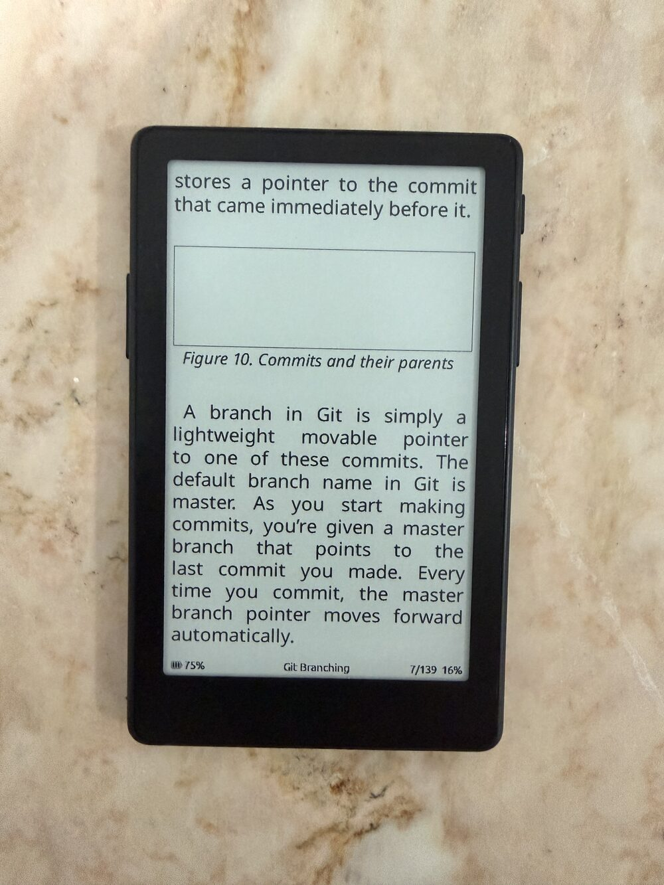
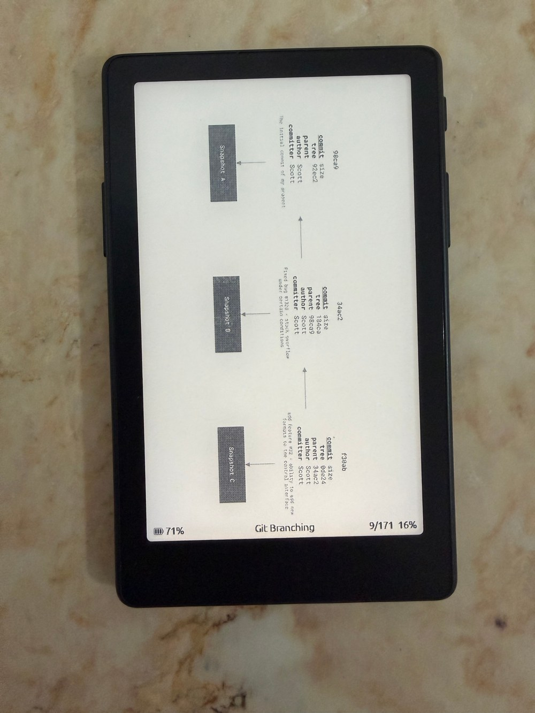
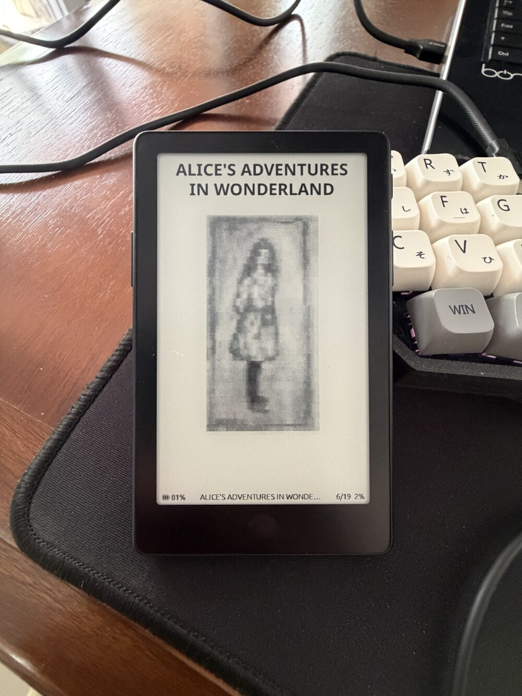

# prensa

Optimize EPUBs for e-ink readers before copying them to the device.

Most EPUBs are made for phones and computers: large color images, progressive
JPEGs, embedded fonts. Small e-ink readers with little memory struggle with
them. `prensa` writes a smaller, sharper copy of the book and never touches
the original. It is tuned on an **Xteink X4 Pro** running the
[CrossPoint](https://github.com/crosspoint-reader/crosspoint-reader) firmware,
but the output is a standard EPUB that opens in any reader.

- **In the browser:** [optimize an EPUB online](https://eosalinas.github.io/prensa/),
  nothing is uploaded.
- **In the terminal:** `cargo install prensa-cli`, then
  `prensa book.epub book-optimized.epub`.

## Before and after

Photos of the same page on an Xteink X4 Pro (CrossPoint), original book on the
left, `prensa` output on the right.

### Missing image → visible

Wide PNG diagrams overflow CrossPoint's PNG line buffer and are silently
dropped. `prensa` downscales them, so they show up.

| Before | After |
|---|---|
|  |  |

*Pro Git, Figure 10. 24 of the book's 188 images are dropped by the firmware; after `prensa`, all of them render.*

<details>
<summary>Optional: turn small diagrams with <code>--rotate cw</code></summary>

Diagrams that would be shrunk to less than a third of their size are turned
90° to fill the screen's height instead, up to 1.67× larger. Turn the device
to read them.

| `prensa` | `prensa --rotate cw` |
|---|---|
|  |  |

*Pro Git, Figure 10. 68 of the book's 188 images are turned; the rest stay upright.*

</details>

### Blurry → sharp

CrossPoint decodes progressive JPEGs at 1/8 resolution. `prensa` re-encodes
them as baseline JPEGs.

| Before | After |
|---|---|
|  |  |

*Alice's Adventures in Wonderland, illustrated by Arthur Rackham (images converted to progressive JPEG to reproduce the issue).*

### File size

| Book | Original | Optimized | Reduction |
|---|---|---|---|
| Pro Git (2.1.450) | 13.99 MB | 2.68 MB | −81% |
| Mastering Bitcoin (3rd ed.) | 6.6 MB | 2.0 MB | −70% |

## Install

Requires a Rust toolchain (1.88 or newer).

```sh
cargo install prensa-cli
```

To build the latest unreleased version instead:

```sh
cargo install --git https://github.com/eoSalinas/prensa prensa-cli
```

## Usage

```sh
prensa book.epub book-optimized.epub
```

```text
✓ Fonts    13 removed (0.38 MB)
✓ Images   187 optimized, 1 kept (13.21 MB → 2.28 MB)
✓ Wrote book-optimized.epub  13.99 MB → 2.68 MB (-81%)
```

Then copy `book-optimized.epub` to the device. Colors and the progress bar
turn off when the output is piped or `NO_COLOR` is set.

| Option | Default | Description |
|---|---|---|
| `--device <x4\|x3>` | `x4` | Screen to fit images to: `x4` for the X4, X4 Pro and X4 Classic (440×733), `x3` for the X3 (484×726) |
| `--max-width <PX>` | from `--device` | Maximum image width |
| `--max-height <PX>` | from `--device` | Maximum image height |
| `--quality <1-100>` | `92` | JPEG quality |
| `--sharpen <SIGMA>` | `0.8` | Unsharp mask after downscaling; `0` disables it |
| `--rotate <off\|cw\|ccw>` | `off` | Turn small wide diagrams 90° to fill the screen's height |

The defaults won a side-by-side comparison on the device. They favor
legibility over the smallest possible file.

## What it does

- **Fonts:** removes embedded fonts. CrossPoint always renders with its own
  fonts, so they are dead weight.
- **Images:** fits every image to the screen (never upscales), converts it to
  grayscale and writes JPEGs as baseline. An image that did not need to change
  is kept when the result would not be smaller.
- **Formats:** converts what CrossPoint cannot show. WebP and BMP become JPEG
  or PNG, and images embedded in chapters as `data:` URIs move to their own
  files. Every reference in chapters, CSS and the manifest is updated.
- **Text:** the visible text and the elements around it stay identical, so
  reading positions saved by sync services such as KOReader's stay valid.
  This is checked by a property-based test over randomly generated books.
- **Files:** the input is never modified; the output is written atomically and
  is a valid EPUB container.

## Limitations

- Tuned for CrossPoint on the X4's 480×800 screen. The X3 profile has not been
  compared on the device yet.
- Readers that use embedded fonts (e.g. KOReader) fall back to their own fonts.
- Panoramic diagrams stay small, even with `--rotate`.
- Thin light-gray lines can look dashed after the device's 4-level dithering.
- Images are converted to grayscale, so color e-ink screens (e.g. Kobo Libra
  Colour) lose color.

## Library

The optimizer is the [`prensa`](crates/prensa) library crate; the CLI
(`crates/prensa-cli`) and the web page (`crates/prensa-wasm`) are thin front
ends over it. See its [documentation](https://docs.rs/prensa) to use it from
Rust.
